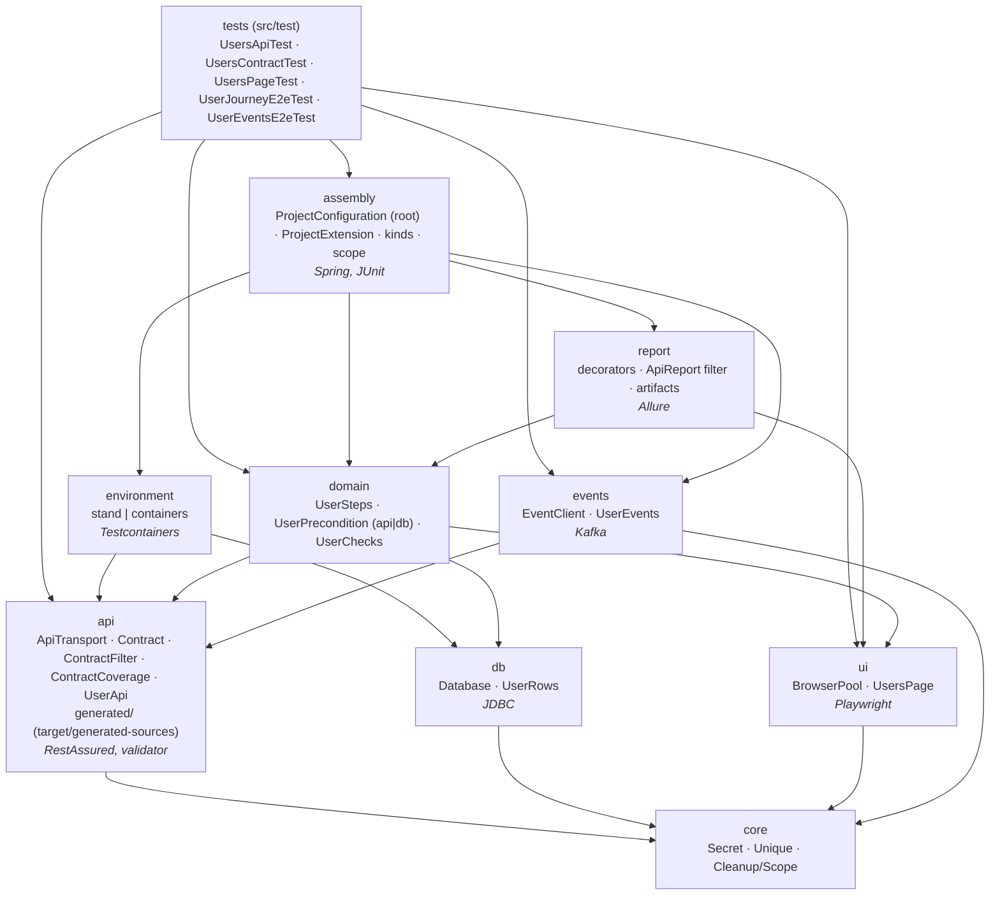

# project/junit — stage 5a: a working test project in one module (JUnit 5)

What a team would start a real automation repository with, for the same SUT and stack as `template/`: UI
(Playwright, desktop and mobile web), API (RestAssured), DB (JDBC), events (Kafka), Spring Boot test context,
Testcontainers, Allure. Two differences from `template/`, both on purpose:

1. **One Maven module, layers as packages** ([ADR 0012](../../docs/adr/0012-module-granularity.md)). The dependency
   direction is not given up: `ArchitectureTest` enforces it, plus what modules cannot express (where each tool may
   appear, what a test may touch).
2. **The API client is generated from the SUT's OpenAPI** and every response is checked against the same file
   ([ADR 0013](../../docs/adr/0013-openapi-client.md)).

It stands alone: no dependency on `framework/`, `template/` or its TestNG twin ([`project/testng`](../testng/README.md), stage 5b), only
on the SUT's contract `sut/src/main/resources/openapi.yaml` and the SUT image for Testcontainers. The code started as
a copy of those modules; what changed is listed below.

## Packages



Arrows are the allowed dependencies (`ArchitectureTest.layers`); everything goes to `core`. Tests reach `api` for
`UserApi`, records and `ApiResponseAssert` only, never the transport or the generated client. `events → api`: the
event payload is the API's user, so it is parsed into the same record.

## What changed against `template/`

| Topic | `template/` | here | Why |
|---|---|---|---|
| Layout | stage 2 modules reused + assembly module | one module, packages | ADR 0012: one consumer, one team |
| API client | hand-written `ApiClient` (paths, DTOs) | generated operations and models, hand-written `ApiTransport` + `UserApi` over them | ADR 0013: the shape cannot drift from the contract |
| Contract | none | `UsersContractTest`: one test per response of `openapi.yaml`; `ContractFilter` reports a drift met by any other test as a broken step (ADR 0015) | drift is one red contract test with a report, and does not block the functional verdicts |
| Report of steps | decorators + AspectJ load-time weaving (stage 2 classes are final, no seams) | decorators + `AllureRestAssured` filter; no `UserSteps` step, no agent | the code is ours: seams instead of weaving; `UserSteps` is made of reported actions |
| Environment settings | records inside `TemplateProperties` | `StandSettings`, `ContainersSettings` in `environment` | the environment does not depend on the assembly |
| Health probe | `ApiClient.get("/health")` | `SutHealth` (generated operation stays in `api`) | found by `ArchitectureTest` |
| Runner | JUnit in `template` root package | JUnit only in `assembly` (rule) | the TestNG project differs in `assembly` only |

## What to look at

| Where | What |
|---|---|
| `sut/src/main/resources/openapi.yaml` | the provider's contract: operations, schemas, the enum of error codes |
| `pom.xml` | generator config (`rest-assured`, Jackson, jakarta, no nullable wrappers); the contract copied to `contract/` on the class path |
| `api/ApiTransport` | the generated client configured once per run; `send(client -> client.users().getUser().idPath(7))` → `ApiResponse` with the exchange |
| `api/Exchange` | a per-call filter that records request and response; why: failure messages without a debugger |
| `api/Contract` | response validation only; requests are negative-test material |
| `api/ContractFilter` | every response of the run checked and reported, never failed; every call counted in `ContractCoverage` (ADR 0015) |
| `target/contract-coverage.md` | after a run: each response of the contract with its number of calls, `never seen`, and what the contract does not declare (`report/ContractCoverageFile`) |
| `api/users/UserApi` | the anti-corruption layer: generated models in, project records out |
| `assembly/ProjectConfiguration` | the root; filters order: contract outermost, report, recorder innermost |
| `report/ApiReport` | the Allure filter handed to the transport: the api layer runs it without knowing Allure |
| `ArchitectureTest` | layers in one module; generated client only in `api`; each tool in its package (Spring, JUnit → `assembly`; Testcontainers → `environment`; Allure → `report`; Kafka → `events`, `environment`; RestAssured → `api`, `report`; Playwright → `ui`; JDBC → `db`); test rules (no transport, no `new` of services, no base class, one kind, no Spring) |
| `api/ContractFilterTest` | the contract check on a fake SUT: missing field, unknown error code, undeclared status — reported by the filter, failed by `conformsTo`; a forbidden request still sent |
| `tests/UsersContractTest` | the contract tests: 14 responses (operation × status × body), status first, then `conformsTo`; the matrix in ADR 0015 |
| `tests/*` | the same test bodies as `template/`, only the imports differ |

## Run

```
mvn -q -pl sut -am package -DskipTests                               # the SUT image is built from sut/target/sut.jar
mvn -q -pl project/junit verify                                      # hermetic: needs only Docker (and Chromium)
mvn -q -pl project/junit verify -Dgroups=api                         # one kind: api, contract, ui, e2e, events
mvn -q -pl project/junit verify -Dspring.profiles.active=mobile,db   # phone context, DB preconditions
mvn -q -pl project/junit verify -Dspring.profiles.active=stand       # against docker compose (sut/README.md)
mvn -q -pl project/junit test -Dtest='ArchitectureTest,ContractFilterTest' -Dsurefire.failIfNoSpecifiedTests=false
mvn -q -pl project/junit allure:serve                                # the report of the last run
```

Chromium for Playwright is installed once, explicitly: see `framework/ui/README.md`.

## Pros and cons

- \+ One pom, one place to look; layers still visible (packages) and enforced (ArchUnit runs without a stand).
- \+ The contract is executable: a moved path needs only a rebuild, a renamed operation or parameter is a compile
  error in `UserApi`, a changed response is a red test with the validator's report.
- \+ The runner is confined to `assembly`: switching JUnit ↔ TestNG touches one package:
  [`project/testng`](../testng/README.md) is the same `src/main` but `assembly/`, checked by `project/check-twins.sh`
  (ADR 0014).
- − Boundaries are a test, not the compiler: a violation compiles and turns red in `verify`.
- − The generator is a build dependency with quirks (a schema `Error` becomes a class `Error`, `null` handling by
  options); review the generated diff on upgrade.
- − Copied, not shared, with `template/`: in this repository on purpose (two independent "repositories"); in real life
  the second project would depend on a published library (ADR 0012, "several teams").

## When not to

- A handful of API checks with no UI or DB: the generated client plus a few tests is enough; skip domain, report
  decorators, environment providers.
- No contract owned by the service team: generating from a spec nobody maintains adds a second source of truth;
  keep a hand-written client (ADR 0003) until the spec is real.
- Several teams consume the clients: split into modules by consumer (ADR 0012), not one module for everyone.

## Try it yourself

1. Rename `createdAt` in the SUT's JSON (`sut/.../User.java`) without touching `openapi.yaml`; run `UsersApiTest`.
   Which test fails first, and what does the message say?
2. Add an error code `age_negative` to the SUT only. Which tests notice? Now add it to the contract too.
3. Add `PATCH /api/users/{id}` to the contract; regenerate (`mvn -q -pl project/junit generate-sources`) and add
   `UserApi.rename`. How many files changed? Which ones would change in a project where tests call the generated
   client directly?
4. Put `@Autowired` on a field of `UsersApiTest`, then `new ApiTransport(...)` in a test body: what does
   `ArchitectureTest` say?
5. Provider side: write a test in `sut/` that runs the in-process SUT and validates its responses against
   `openapi.yaml`. What does it catch that this project cannot (hint: endpoints no consumer calls)?
