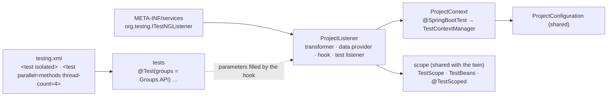

# project/testng — stage 5b: the same working test project on TestNG

The twin of [`project/junit`](../junit/README.md): the same SUT, stack, layers, composition root, test scope,
configuration and test bodies — only the runner glue in `assembly/` is TestNG ([ADR 0014](../../docs/adr/0014-junit-vs-testng.md)).
Like its twin it stands alone: no dependency on `framework/`, `template/` or `project/junit`, only on the SUT's
contract `sut/src/main/resources/openapi.yaml` (ADR 0013) and the SUT image for Testcontainers.

`project/check-twins.sh` proves the "only": everything in `src/main` except the top-level `assembly/*.java` and
`META-INF/services` is byte-identical to the JUnit twin (`ProjectConfiguration`, `ProjectProperties` and
`assembly/scope` included). CI runs it.

## Packages

The same as [`project/junit`](../junit/README.md#packages); `assembly` holds TestNG instead of JUnit:



## JUnit 5 vs TestNG, side by side

| | `project/junit` | here | Why it differs |
|---|---|---|---|
| A test class | `@ApiTests class UsersApiTest` | `@Test(groups = Groups.API) public class UsersApiTest` | TestNG has no meta-annotations: the kind is a group |
| A test method | `@Test void registers(UserSteps users, UserChecks checks)` | `@Test public void registers(UserSteps users, UserChecks checks)` | same body; TestNG runs public methods of a class-level `@Test` |
| Where the wiring is registered | `@ExtendWith` inside the kind annotation | `META-INF/services` → `ProjectListener` | a listener in `testng.xml` would be missing in an IDE run of one class |
| Spring context | `SpringExtension` | `TestContextManager(ProjectContext)` in the listener | the official TestNG way is a base class (`AbstractTestNGSpringContextTests`) |
| Parameters | `ParameterResolver` | transformer adds data provider `project-beans` (a row of `null`s), `IHookable` fills it | TestNG injects only its own types |
| Instances | one per test method | one per class, shared by parallel methods | → ArchUnit: no instance fields in tests |
| Test scope | opened while resolving, closed in `afterEach` | opened while resolving, closed in the hook's `finally` | same `TestScope`, same rule: bound only while resolving |
| Kind check | exactly one kind annotation | exactly one kind group on the class, none on methods | ArchUnit, both |
| Environment down | class disabled with the reason | `SkipException` with the reason | `project.require-environment=true` fails, both |
| Screenshot on failure | `AfterTestExecutionCallback` | in the hook, before the browser goes back to the pool | `onTestFailure` comes after the hook |
| Retry (CI only) | Surefire `rerunFailingTestsCount` | `IRetryAnalyzer` (`ProjectRetry`), `rerun.count` from the same Maven profile `ci` | Surefire's rerun is JUnit-only |
| Flaky | Surefire XML `flakyFailure` | retried attempt = skipped "retried"; `target/flaky-tests.txt` | |
| Parallelism | `junit-platform.properties` | `testng.xml` `parallel="methods" thread-count="4"` | |
| Isolation | `@Isolated` | group `isolated` + the class listed in its own `<test>`, run first | `-Dgroups` replaces groups of every `<test>` |
| Class needing fields | — (instance per method) | `@Test(singleThreaded = true)`, fresh fields in `@BeforeMethod` | `ContractFilterTest`, `TestScopeTest`, `ReportingTest` |
| `@TempDir`, assumptions | JUnit built-ins | `Files.createTempDirectory`, `SkipException` | |
| Allure | `allure-junit-platform` | `allure-testng` | both via ServiceLoader |
| Surefire provider | JUnit Platform (auto) | `surefire-testng`, named in the pom | the parent puts Jupiter on every class path |
| ArchUnit | `archunit-junit5`, `@ArchTest` fields | `archunit` core, one data-provider invocation per rule field | no JUnit engine in this module |
| JUnit in the module | only in `assembly` | nowhere (rule) | a JUnit `@Test` here would compile and never run |

## What to look at

| Where | What |
|---|---|
| `assembly/ProjectListener` | the whole glue: transformer (data provider, retry), `IHookable.run` (context, environment, parallelism, scope, screenshot), `onTestStart` (clean report names), `onTestSuccess` (flaky) |
| `assembly/Groups` | kinds as constants; why a kind cannot be an annotation here |
| `assembly/ProjectContext` | `@SpringBootTest` on a class no test extends |
| `assembly/ProjectRetry` | in-process retry, CI only |
| `src/test/resources/testng.xml` | parallel methods, the isolated `<test>`, packages recursively minus the fixtures |
| `assembly/ProjectListenerTest` + `assembly/fixtures` | the listener end to end through a programmatic TestNG: skip/fail policy, parameters, one bean per method on one instance in parallel, threads > browsers, flaky |
| `ArchitectureTest` | the twin's rules + "no JUnit", "no instance fields in tests", "kinds only in `tests`" |
| `../check-twins.sh` | the diff against the twin |

## Run

```
mvn -q -pl sut -am package -DskipTests                                # the SUT image is built from sut/target/sut.jar
mvn -q -pl project/testng verify                                      # hermetic: needs only Docker (and Chromium)
mvn -q -pl project/testng verify -Dgroups=api                         # one kind: api, contract, ui, e2e, events
mvn -q -pl project/testng verify -Dspring.profiles.active=mobile,db   # phone context, DB preconditions
mvn -q -pl project/testng verify -Dspring.profiles.active=stand       # against docker compose (sut/README.md)
mvn -q -pl project/testng test -Dtest='ArchitectureTest,ContractFilterTest'   # bypasses testng.xml
mvn -q -pl project/testng verify -Pci                                 # one retry per failed test, flaky list
mvn -q -pl project/testng allure:serve                                # the report of the last run
project/check-twins.sh                                                # what differs from project/junit
```

Chromium for Playwright is installed once, explicitly: see `framework/ui/README.md`.

## Pros and cons (against the JUnit twin)

- \+ The runner swap is one package, checked by a script: the layering paid off.
- \+ The suite file is one place for the run's shape (parallelism, isolation, the test set), familiar to TestNG teams.
- − More glue and more TestNG internals for the same behaviour: four extension points instead of one
  `ParameterResolver`; one hookable and one transformer per run; the listener must come before Allure's.
- − One instance per class: a rule against fields, `singleThreaded` for component tests with state; setup that JUnit
  puts in `@BeforeEach(UserSteps)` goes into the test body.
- − A test cannot combine its own `@DataProvider` with bean parameters.

## When not to

- A new project with a free choice: JUnit 5 does this with less glue (ADR 0014, "When to pick which").
- Spring-heavy component tests (`@MockitoBean`, `@Sql`, `@DirtiesContext`): the listener does not drive Spring's test
  execution listeners; use JUnit or `AbstractTestNGSpringContextTests`.

## Try it yourself

1. Add a field `private User ada;` to `UsersApiTest`, set it in one test and read it in another. Run with
   `thread-count="1"`, then `4`: what changes? What does `ArchitectureTest` say?
2. Put `@org.junit.jupiter.api.Test` on a new method. Is it green in the IDE? Does `mvn verify` run it?
3. Remove `META-INF/services/org.testng.ITestNGListener` and add `<listeners>` to `testng.xml`. Run `mvn verify`, then
   one test class from the IDE. What breaks, and where?
4. Give `UsersApiTest` a `@DataProvider` of countries and a parameter `String country` next to `UserSteps`. What does
   the transformer do? How would you combine both (hint: the hook knows which parameters are `null`)?
5. Run `mvn -q -pl project/testng verify -Dgroups=api` with the isolated `<test>` switched back to
   `<groups><run><include name="isolated"/>`. Count the API tests in the report.
