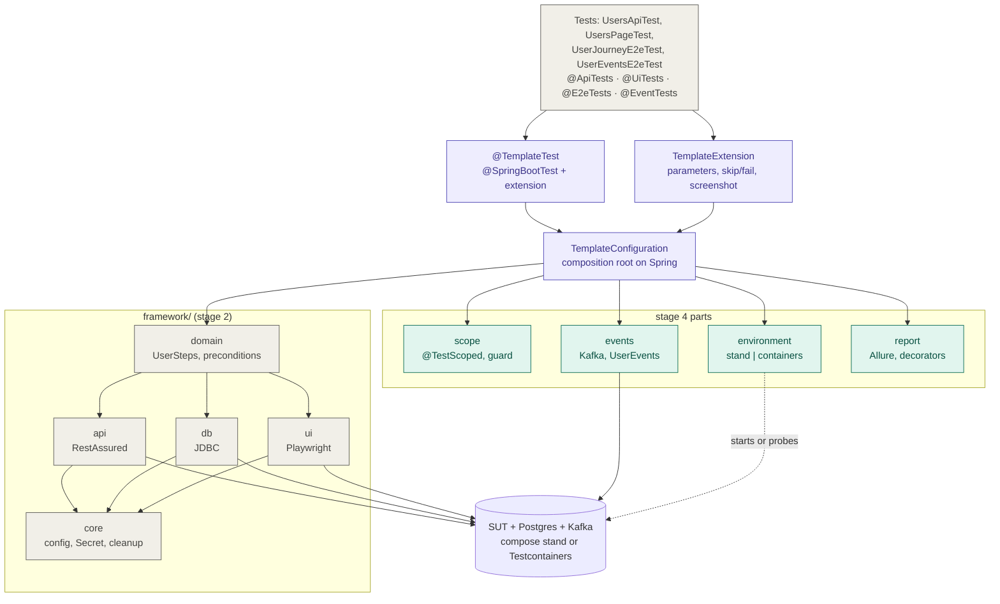
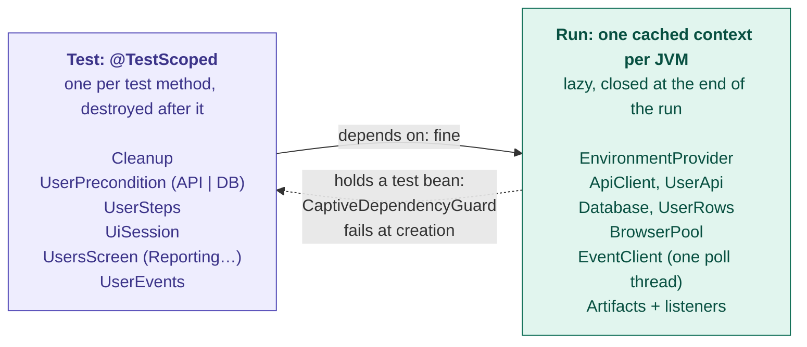

# template — stage 4: Spring Boot test context + Testcontainers + Kafka events + report and CI

The working template. The stage 2 layers (`framework/core`, `api`, `db`, `ui`, `domain`) are reused **as they are**;
only the assembly is new: a Spring Boot test context instead of the hand-written root, and an environment that is
either a running stand or started by the run itself with Testcontainers.

The point to see: the three test classes of `framework/tests` moved here with one changed line (`package`).
Nothing below the assembly knows about Spring, Docker or which environment ran.

## Architecture

### Layers



- **Call path.** A test carries a kind annotation (`@ApiTests` etc.). The kind includes `@TemplateTest`, which brings
  `@SpringBootTest` and `TemplateExtension`. The extension resolves test method parameters (no `@Autowired`), skips
  the test when the environment is unavailable (fails it under the `ci` profile) and saves a screenshot when a UI test fails.
- **The root.** `TemplateConfiguration` has one `@Bean` per binding, no scanning. The two choices are each a `switch` on an enum:
  the environment (stand or containers) and the precondition channel (API or DB).
- **The stage 4 parts** do not know each other; only the root wires them. Each tool is confined to its package:
  Testcontainers to `environment`, Kafka to `events` and `environment`, Allure and AspectJ to `report`, Spring to the root
  and `scope`. `ArchitectureTest` checks this.
- **Stage 2 layers** are reused as they are: the tests moved here by changing their `package` line only.

### Bean lifetimes



The context is cached, so the environment and the browser pool start once per run. Beans that hold a test's state
are `@TestScoped`. A run bean holding a test bean would be a captive dependency: it would keep the first test's object
for the whole run. `CaptiveDependencyGuard` refuses it when the bean is created, not somewhere in the middle of the run.
A test class that changes the configuration (`@TestPropertySource`, `@MockitoBean`, another profile) gets a second
context and with it a second environment: keep test classes on the plain kinds.

| Where | What to look at |
|---|---|
| `TemplateConfiguration` | the root, Spring edition: one `@Bean` per binding, no scanning, no auto-configuration; `@TestScoped` beans; the two choices (environment, precondition channel) as `switch` on enums |
| `TemplateProperties` + `application*.yml` | every key, typed records; `ignoreUnknownFields = false` (a typo fails); profiles `stand`, `ci`, `mobile`, `db` as slices that combine |
| `scope/TestScope` | the test scope Spring does not have; bound to the thread only while a test's parameters are resolved |
| `scope/CaptiveDependencyGuard` | a singleton holding a test bean fails at creation, as in stage 2 |
| `TemplateExtension` | parameters without `@Autowired`; skip or fail when the environment is unavailable; parallelism within the browser pool; screenshot of a failed UI test → `Artifacts` |
| `environment/` | `EnvironmentProvider` seam; `StandEnvironment` (connect + probe), `ContainersEnvironment` (Postgres + Kafka + SUT image, private network, random ports, generated password); `eventsUnavailable()` — the broker as a capability |
| `events/` (4b) | `EventClient` (one consumer thread per run, `assign` + per-listener start offsets), `Event`, `EventSubscription`, `SwitchableListener`, `EventWaiter` — from the stage 4 note and the kata, no Spring |
| `events/users/UserEvents` (4b) | the SUT's `users` topic as a test sees it; `@TestScoped`: subscribed before the test body, closed after it; finds by user id, keeps what it skipped |
| `report/` (4c) | `Artifacts` + `ArtifactListener` (Observer: files, Allure); `ReportingUserPrecondition`, `ReportingUsersScreen` (decorators over stage 2 interfaces); `ReportingAspect` + `META-INF/aop.xml` (steps of final classes, woven at load time) |
| `@ApiTests` / `@UiTests` / `@E2eTests` / `@EventTests` → `@TemplateTest` | test kinds: a tag + `@SpringBootTest` + the extension; one cached context for the run; `@EventTests` also need a broker |
| tests | `UsersApiTest`, `UsersPageTest`, `UserJourneyE2eTest` — copies of stage 2; `UserEventsE2eTest` — API/page → `user.created`; `events/EventClientTest` — the client against its own broker; `report/ReportingTest`, `report/ArtifactsTest` — what reaches the report; `scope/TestScopeTest`, `TemplatePropertiesTest`, `TemplateExtensionTest` — the mechanics |
| `ArchitectureTest` | the layer rules as ArchUnit tests, no environment needed. The module: only the root wires `environment`/`events`/`report`/`scope`, which do not know each other; Spring only in the root and `scope`, Testcontainers only in `environment`, Allure and AspectJ only in `report`, Kafka only in `events` and `environment`; the stage 2 layers free of all of them. Assembly tests (a kind, top level): the rules of `framework/tests` — no transport, no `new` of services, no base class, exactly one kind — plus no tool of stage 4 and no Spring at all (`@TestPropertySource`, `@MockitoBean`, `@Autowired`: another configuration is another context and another environment). Component tests of the parts use their tool and are not subject to the test rules |

## Run

```
mvn -q -pl template -am verify                                    # hermetic: needs only Docker
mvn -q -pl template -am verify -Dgroups=ui                        # one kind (api, ui, e2e, events)
mvn -q -pl template -am verify -Dspring.profiles.active=mobile,db # same tests, phone context, DB preconditions
mvn -q -pl template -am verify -Dspring.profiles.active=stand     # against docker compose (see sut/README.md)
mvn -q -pl template -am verify -Dspring.profiles.active=ci        # unavailable environment fails, not skips
mvn -q -pl template -am test -Dtest=ArchitectureTest -Dsurefire.failIfNoSpecifiedTests=false   # layer rules only
```

Against the compose stand with events (`SUT_KAFKA_BOOTSTRAP=kafka:19092 docker compose --profile events up -d --build --wait`):

```
mvn -q -pl template -am verify -Dspring.profiles.active=stand -Dtemplate.stand.kafka-bootstrap=localhost:9094
```

Report (stage 4c): after a run, `mvn -pl template allure:serve` opens it; `allure:report` writes
`target/site/allure-maven-plugin`. Retry as in CI: `CI=true mvn -q -pl template -am verify` (or `-Pci`).

Any key also from the environment: `TEMPLATE_UI_PROFILE=mobile`, `SPRING_PROFILES_ACTIVE=stand`.
`-am` matters for the containers mode: it packages `sut/target/sut.jar`, which the image is built from.

## Stage 2 → stage 4a

| Stage 2 (`framework/tests`, ADR 0001, 0002) | Here (ADR 0008, 0009) |
|---|---|
| `b.run(X.class, c -> new X(c.get(Y.class)))` | `@Bean X x(Y y) { return new X(y); }` |
| `b.test(...)`, TEST lifetime from the JUnit store | `@Bean @TestScoped`, custom `TestScope` |
| `c.cleanup().own(resource)` | the bean's destroy method (`close` is inferred), registered with the test scope |
| RUN objects built lazily | `spring.main.lazy-initialization: true` |
| one run scope per root, `static`-free | Spring's context cache: one context per configuration per JVM |
| `Config`: sysprop → env → `env/<env>.properties` → `framework.properties`; catalogue catches typos | Spring Boot: sysprop → env → `application-<profile>.yml` → `application.yml`; `ignoreUnknownFields = false` |
| `Secret` from `ConfigReader.secret` | `Secret` bound by a `@ConfigurationPropertiesBinding` converter |
| captive dependency, TEST in `@BeforeAll`, cycles — refused by the root | captive — `CaptiveDependencyGuard`; `@BeforeAll` / other thread — `TestScope`; cycles — Spring itself |
| parameters resolved by the root | `TemplateExtension` (Spring alone needs `@Autowired` on each test parameter) |
| the stand is given (`docker compose`) | `EnvironmentProvider`: `stand` or `containers` (default) |

## What was checked

| Run | Result |
|---|---|
| default (containers), parallel | 9/9 green; environment up in ~6 s (Postgres ~1 s, image build ~3 s, SUT ~1 s); whole module ~30 s |
| `stand` profile against compose | 9/9 green; rows in `users` before = after (cleanup works for both modes) |
| `mobile,db` on containers | 9/9 green — no test changed |
| `stand` + `template.ui.timeout=1ms` | UI tests fail, one screenshot per failed test (since 4c in `target/artifacts/` and in Allure), still no rows left |
| no `sut.jar` (`-Dtemplate.containers.sut-build-dir=/nowhere`) | skipped: "No /nowhere/target/sut.jar to build the SUT image from: mvn -q -pl sut -am package -DskipTests" |
| the same with profile `ci` | fails with that reason |
| mechanics (no Docker needed) | `TestScopeTest` 5, `TemplatePropertiesTest` 5, `TemplateExtensionTest` 5 |

Findings:
- Spring infers a destroy method from the **object**, not the declared type: the `Cleanup` bean is the test's own
  `Scope` and would have been registered to close itself — `@Bean(destroyMethod = "")`.
- `@SpringBootTest` resolves a test method parameter only with `@Autowired`; without our resolver, the stage 2 tests
  do not run unchanged.
- An exception from an `ExecutionCondition` reaches the report wrapped ("Failed to evaluate condition [...]: ");
  the reason is still the first thing after it.
- `commons-logging` from RestAssured's httpclient next to Spring's `spring-jcl` prints a warning on every start;
  excluded in this module only.
- Testcontainers 1.21.4 (managed by Boot 3.5.16) works with Docker Engine 29; the first Ryuk start once took 30 s,
  later ones ~0.4 s.

## Stage 4b: events

```
test thread                      event-client-poll (one per run)                    SUT
UserEvents created (param) ──subscribe──▶ assign + endOffsets → listener start
users.registerThroughApi ─────────────────────────────────────────────────────▶ POST → insert → send (async)
events.created(id)  ◀──queue── dispatch: offset ≥ start? ◀── poll ◀── topic users ◀──┘
```

```java
@EventTests
class UserEventsE2eTest {
    @Test
    void userCreatedThroughApiIsAnnounced(UserSteps users, UserEvents events) {
        User ada = users.registerThroughApi(users.aNewUser());
        assertThat(events.created(ada.id())).contains(ada);   // waits up to template.events.timeout
    }
}
```

| Kata (fake broker, stage 1) | Here (real broker) |
|---|---|
| `FakeBroker`, one partition, synchronous | Kafka in a container, 3 partitions, `assign` + `seekToEnd` + `position` |
| one start for the whole client | a start per listener (end offsets at subscribe): the shared position may lag |
| registration before the assign | registration on the poll thread, between two polls |
| `pollMatching` drops the noise | `UserEvents` keeps it: the test may wait for it next |
| a test field for the client | a run bean + a `@TestScoped` subscription: Spring closes both |

What the real broker found is in [ADR 0010](../docs/adr/0010-events-kafka.md): the late listener got old events;
a topic created a moment ago was "not found"; `pollMatching` dropped an event a later wait needed.

Checked: default (containers) — 37 tests green, environment with Kafka up in ~5 s (Kafka and Postgres in parallel);
`EventClientTest` 5 runs in a row green; `stand` + compose `--profile events` + `kafka-bootstrap=localhost:9094` —
event tests green, `users` rows before = after; `stand` without the key — 3 event tests skipped with the reason.

## Stage 4c: report, retry, parallel run, CI

```
JUnit Platform ──events──▶ allure-junit-platform (Observer, ServiceLoader) ──▶ target/allure-results
   test body ── UserSteps.registerThroughUi ◀── ReportingAspect (woven: final class, no seam)
                  └─ UsersScreen.create      ◀── ReportingUsersScreen (decorator: interface = seam)
                  └─ ApiClient.send (private) ◀── ReportingAspect: "POST /api/users -> 201" + request/response
   failed UI test ── TemplateExtension ──▶ Artifacts ──▶ ArtifactFiles (target/artifacts)
                                                      └─▶ AllureArtifacts (attachment)
```

What one E2E test looks like in the report (`UserJourneyE2eTest`, from `allure-results`):

```
UserSteps.aNewUser                         result=NewUser[name=Ada ..., email=ada-...@example.test]
screen: open users
UserSteps.registerThroughUi                screen=ReportingUsersScreen, user=NewUser[...], result=ShownUser[id=7 ...]
  screen: create ada-...@example.test      form=UserForm[...]
GET /api/users/7 -> 200                    [response]
screen: delete ada-...@example.test
GET /api/users/7 -> 404                    [response]
GET /api/users?{email=ada-...} -> 200      [response]      <- the test's cleanup, after the body
```

| Concern | Here | Stage 1 / 2 |
|---|---|---|
| Who calls the report | nobody: the engine notifies, listeners observe | — |
| Steps of a class with an interface | decorator, wired in the root (explicit, compile-checked) | principles/decorator |
| Steps of a final class | aspect, woven at load time (no change to the class, names by string) | — |
| Screenshot | published to observers; the extension does not know where it lands | printed path |
| Retry | CI only, once; green on the second attempt = flaky, listed, never hidden | `principles/invariants/retry`: retry the *operation* that is allowed to fail, not the test |
| Parallelism ≤ browsers | refused at start with the reason | a comment in `junit-platform.properties` |
| A class that must run alone | `@Isolated` (`ReportingTest` swaps Allure's global lifecycle) | — |

Retry policy, the one-line version: **a retry must not change what a person learns from the run.** Locally nothing
is retried (the author sees the failure). In CI a failed test runs once more in the same JVM (same context, same
environment); green on the second attempt is green for the build, and a *flake* in four places: Surefire's
`Flakes:` line and `flakyFailure` in the XML, both attempts in Allure (Retries tab, flaky mark, retry trend), the
job summary and a warning annotation of the pipeline. What may retry inside a test (a poll until an event, a
`find` until the page shows a row) is a bounded wait in the client, not a rerun.

CI ([`.github/workflows/tests.yml`](../.github/workflows/tests.yml)): JDK 17 + cached Maven and Chromium
(`install --with-deps`), the compose stand for stage 2 (`-Dstand.required=true`), template on its own
containers (`-Dspring.profiles.active=ci`), `mvn -B verify` of the whole reactor; flakes into the summary;
the Allure report with history from the published site → an artifact of every run and GitHub Pages from `main`
(a red run publishes too — that is when it is read).

Checked:

| Run | Result |
|---|---|
| default (containers) | 44 tests green, ~21 s for the module; 44 results in `allure-results`, steps and API attachments as above |
| `-Dgroups=ui -Dtemplate.ui.timeout=1ms -Pci` | 4 UI tests fail twice (rerun), a screenshot per attempt: in `target/artifacts` and attached in Allure |
| a test failing only on its first attempt | local: `BUILD FAILURE`; `CI=true`: `BUILD SUCCESS`, `Flakes: 1`, `flakyFailure` in the XML, two Allure results with one `historyId` (failed, passed) |
| `-Djunit...fixed.parallelism=8` (4 browsers) | every template test fails before the environment starts: "JUnit runs up to 8 tests at once, the browser pool has 4 ..." |
| `TemplatePropertiesTest` with `-Dspring.profiles.active=stand` / `ci`, `SPRING_PROFILES_ACTIVE=stand` | green (was red: the machine's properties leaked into "the defaults"; the test now builds its context without them) |
| the CI test step locally (`CI=true mvn -B verify -Dstand.required=true -Dspring.profiles.active=ci`, compose up) | whole reactor green after two fixes it found: `TemplateExtensionTest`'s skip cases now state `require-environment=false` (the global `ci` profile turned them into failures); `--fail-at-end` (a flaky kata stopped the reactor before template). Template 44/44; `allure:report` generated |
| the workflow on GitHub | not run: the repository has no remote yet |
| `ArchitectureTest` with planted violations: a test with two kinds, a base class, `@TestPropertySource`, an `ApiClient` parameter, `new Unique()`, `Allure.step`; Spring + Kafka + Testcontainers in `report`, Allure + `EnvironmentProvider` in `events`, Spring in a `com.study.framework` class | 11/11 rules fail, each naming the class, the member and the line. Finding: the first version flagged `environment` reading `TemplateProperties` — the exception has to cover its nested records (`belongToAnyOf`, not `equivalentTo`) |

## Pros and cons

| + | − |
|---|---|
| Profiles, env vars, typed binding, integrations expect Spring — less own code to maintain | Three Spring gaps closed by hand (test scope, parameters, destroy inference); someone must own those classes |
| The graph is still in one class, readable top to bottom | `@Bean` methods look like plain code, but lazy init, scopes and inferred destroy are behaviour you do not see |
| Hermetic by default: a clean machine with Docker runs everything | Docker everywhere; ~6 s before the first test; a stale jar is a stale SUT |
| One environment per run without static state (context cache) | Any per-class configuration change silently starts a second context and environment |
| Events through the same graph: a test asks for `UserEvents` like for `UserApi` | The poll thread runs every listener of the run: one slow listener delays all event tests |
| A report with steps, HTTP and screenshots, and stage 2 did not change for it | An aspect names methods by string; a run without the agent (IDE) has no steps — a test guards both |
| A flaky test is green and visible at once | A rerun doubles the time of a really broken test; somebody must read the flaky list |

## When NOT to apply

- A small suite against one fixed stand: the hand-written root (stage 2) is less to learn and has no gaps to close.
- Component scanning "to save the `@Bean` methods": the saving is lines, the cost is a graph nobody can read.
- Testcontainers when the environment is not yours to start (a shared UAT with real integrations): the stand mode
  exists for that; a container copy of a third-party system is a different test.
- Per-class `@Container` fields for an E2E suite: a database per class multiplies start-up and hides cross-test
  data problems that the shared stand will show.

- Events in a test that can check the result synchronously (the API returned it, the row is there): an event test
  waits, and a missing event costs the whole timeout. Check events when the event **is** the contract.
- A consumer group in a test client: rebalances, committed offsets between runs — see ADR 0010.
- An aspect where an interface exists: the decorator says the same in code the compiler checks.
- AspectJ to report a framework you own: add a neutral `StepListener` port to it instead (ADR 0011, alternatives).
- Retries as a fix: a flake list nobody reads is the same as `@Disabled` with extra CPU.

## Try it yourself

1. Add `@Autowired UserSteps users;` as a field of `UsersApiTest` and run it (`-Dtest=UsersApiTest`: the whole
   module would stop at `ArchitectureTest` first). Read the message; explain why a field is the wrong place in both
   stages. Then compare it with the message of `ArchitectureTest.testsDoNotTouchSpring`: which one comes earlier
   in a developer's day?
2. Make `UserChecks` depend on `Cleanup` in `TemplateConfiguration`. Which class fails, when, with what message?
   Now remove `CaptiveDependencyGuard` from `TestScopeConfigurer` and run the suite in parallel: what goes wrong, and
   how long until someone would notice?
3. Put `@TestPropertySource(properties = "template.ui.headless=false")` on `UsersPageTest` and run the module with
   `-Dtest='Users*Test'` (`ArchitectureTest` forbids it — that is the point of the rule). Count the Postgres
   containers that start (`docker ps` during the run) and explain the time difference.
4. Add a third environment: `ComposeEnvironment` with Testcontainers' `ComposeContainer` over `docker-compose.yml`.
   What has to change outside `environment/`? What collides with a developer's own stand, and how would you avoid it?
5. Replace the `switch` in `environmentProvider` with two `@Bean` methods and `@ConditionalOnProperty`. Mistype the
   value (`contaners`) and compare the error with the enum version.
6. In `EventClient.dispatch`, deliver to every listener regardless of its start (drop `registration.wants`) and run
   `EventClientTest` a few times. Which test fails, and why only sometimes?
7. Write a test that takes `users.existing()` and waits for its `user.created`. Run it as is and with
   `-Dspring.profiles.active=db`. Why does one run fail after 10 s, and what does that say about DB preconditions
   for a system whose consumers rely on its events?
8. Stop the broker in the middle of a run (`docker stop` on the Kafka container). What does the SUT log, what does
   the API return, what does the test report? Where would an outbox change the answer?

9. Rename `ApiClient.send` to `exchange` (stage 2) and run the module. What does the compiler say, what does the
   report lose, which test notices? Now do the same with `UsersScreen.find` and compare.
10. In `ReportingUsersScreen.open`, return `delegate.open()` instead of `this`. Run `UserJourneyE2eTest` and read its
    steps in `allure-results`: which actions are missing, and why does no test fail?
11. Write a test that fails on every second run (a static counter), run with `-Pci`, then `allure:serve`. Find it
    in Retries and in the flaky filter. Then remove the agent from `argLine` and run again: what is red now?
12. Add a third `ArtifactListener` that writes the page's HTML of a failed UI test (`page.content()`). What has to
    change in `TemplateExtension`, and what in `TemplateConfiguration`?
13. `ArchitectureTest` is a copy of the one in `framework/tests` with additions. Extract the shared rules into a
    module both use. What does it cost, what does it save, and at which third consumer would you do it for real?

## Decisions

[ADR 0008 — Spring Boot test context as the composition root](../docs/adr/0008-spring-test-context.md),
[ADR 0009 — environment provider: a running stand or Testcontainers](../docs/adr/0009-environment-provider.md),
[ADR 0010 — events: the SUT publishes to Kafka, one EventClient per run](../docs/adr/0010-events-kafka.md),
[ADR 0011 — report, retry, parallel run and CI](../docs/adr/0011-report-retry-ci.md).
